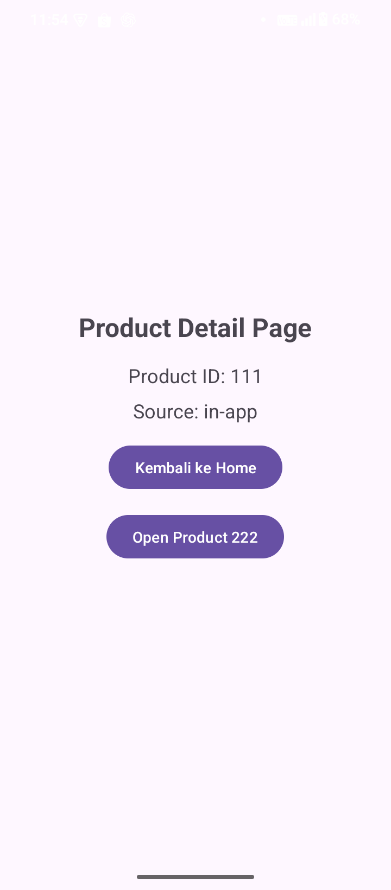
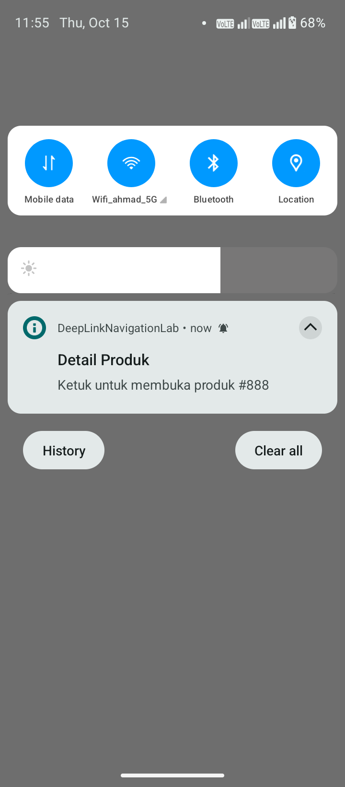

# DeepLinkNavigationLab
[](https://github.com/asaayuti/DeepLinkNavigationLab/actions/workflows/android-build.yaml)

An Android project exploring deep links, Android App Links, navigation behavior, Firebase Hosting, and release signing.

## Overview

This project demonstrates how URLs and Android notifications can navigate users to specific destinations in an Android application.

## Features

- Custom scheme deep links (`myapp://`).
- HTTPS Android App Links with domain verification.
- Navigation arguments and default values.
- Input validation for deep-link parameters.
- Navigation back-stack management.
- Notification navigation with `NavDeepLinkBuilder`.
- Firebase Hosting with product-page fallback routing.
- Release-signed APK and Android App Bundle (AAB).

## Tech Stack

- Java
- Android SDK
- XML layouts
- AndroidX Navigation Component
- AndroidX NotificationCompat
- Firebase Hosting
- Gradle Kotlin DSL

## Requirements

- Android Studio
- Android SDK 37
- Compatible JDK
- Firebase CLI for hosting deployment

Minimum Android SDK: 24.

## Deep Link Examples

### Custom Scheme

```text
myapp://product/123?source=custom-scheme
```

### HTTPS App Link

```text
https://deeplinknavigationlab.web.app/product/123?source=browser
```

### Notification

The notification opens `ProductFragment` with a product ID and source argument.

## Firebase Hosting

Website: https://deeplinknavigationlab.web.app

The hosting directory is `public/`. The Android App Links association file is:

```text
public/.well-known/assetlinks.json
```

Deploy the website with:

```bash
firebase deploy --only hosting
```

The SHA-256 fingerprints in `assetlinks.json` must match the signing certificates used by the relevant builds.

## Build

Build the debug APK:

```bash
./gradlew assembleDebug
```

Build the release APK:

```bash
./gradlew assembleRelease
```

Build the Android App Bundle:

```bash
./gradlew bundleRelease
```

Release builds require a locally configured keystore and `keystore.properties`. Never commit signing credentials or private keys.

## Testing

Test a custom scheme:

```bash
adb shell am start -W \
  -a android.intent.action.VIEW \
  -c android.intent.category.BROWSABLE \
  -d "myapp://product/777?source=custom-scheme"
```

Test an HTTPS App Link:

```bash
adb shell am start -W \
  -a android.intent.action.VIEW \
  -c android.intent.category.BROWSABLE \
  -d "https://deeplinknavigationlab.web.app/product/321?source=promo"
```

Check Android App Links verification:

```bash
adb shell pm get-app-links com.sayuti.deeplinknavigationlab
```

## Security Notes

- Validate incoming deep-link parameters before using them.
- Treat `source` as metadata, not as authorization.
- Keep signing credentials and keystore files out of version control.
- Keep the App Links association file synchronized with the relevant certificate fingerprints.

## Project Status

Developed as a hands-on Android learning project covering deep links, navigation, Firebase Hosting, and release signing.

## Screenshots

### Home Screen


### Product Screen — Deep Link



### Notification Navigation


